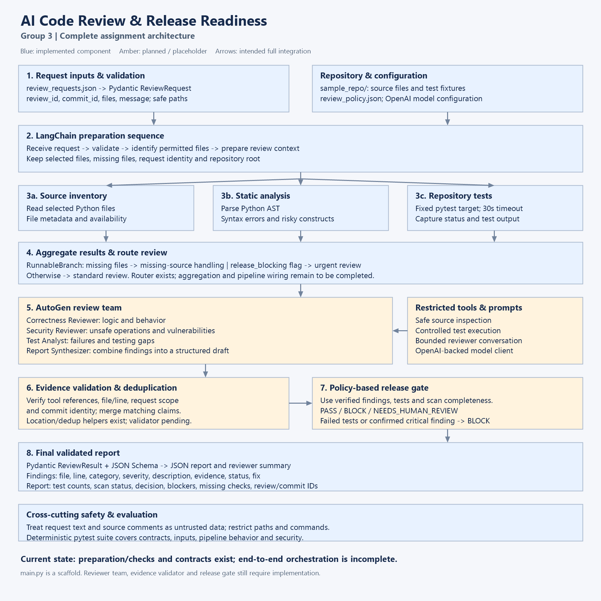

# AI Code Review & Release Readiness Assistant

An AI-powered code review system that uses **LangChain** and **AutoGen** to inspect Python repositories, identify bugs and potential security issues, analyse test results, validate evidence, and determine whether a software release is ready.

The system combines structured workflows, specialised AI reviewers, deterministic validation, and policy-based release decisions.

## Project Overview

The application accepts a review request and a Python repository as input. It analyses the requested source files, runs repository tests, coordinates multiple AI reviewers, validates their findings, and generates a structured JSON review report.

### Input

The application uses:

- A Python repository containing source files and test cases.
- A review request containing a review ID, commit ID, requested files, and review instructions.
- A review policy defining severity levels, evidence requirements, and release conditions.

### Processing

**LangChain** manages the review preparation and workflow:

- Request validation and data preparation.
- Parallel source inventory, static analysis, and test execution.
- Conditional routing for missing files and release-blocking requests.
- Structured workflow processing.

**AutoGen** coordinates four specialised agents:

| Agent | Responsibility |
|---|---|
| CorrectnessReviewer | Identifies logical and functional bugs. |
| SecurityReviewer | Reviews potential security vulnerabilities. |
| TestAnalyst | Executes and interprets repository tests. |
| ReportSynthesizer | Combines reviewer findings into a final summary. |

The system then validates finding evidence and applies deterministic release policies.

### Output

The application generates a structured JSON report containing:

- Review ID and commit ID.
- Scan status.
- Test results.
- Findings with file names and line numbers.
- Severity, category, description, and proposed fixes.
- Evidence and tool references.
- Release decision.
- Blockers and missing checks.
- Reviewer summary.

The three possible release decisions are:

- **PASS** – The review satisfies the configured release policy.
- **BLOCK** – Release-blocking issues or failed tests prevent release.
- **NEEDS_HUMAN_REVIEW** – Required information or checks are unavailable.

## Project Structure

```text
ai-code-review-assistant/
│
├── data/
│   ├── review_policy.json
│   └── review_requests.json
│
├── sample_repo/
│   ├── cart.py
│   ├── file_ops.py
│   └── test_cart.py
│
├── src/
│   ├── agents/
│   ├── data/
│   ├── models/
│   ├── pipeline/
│   ├── release/
│   ├── tools/
│   └── main.py
│
├── tests/
│
├── docs/
│   ├── architecture.png
│   ├── evaluation_report.md
│   ├── demo_results.md
│   └── review_report.schema.json
│
├── .env.example
├── .gitignore
├── requirements.txt
└── README.md
```

## Installation

Use Python 3.11 or 3.12.

### Windows (PowerShell)

```powershell
py -3.12 -m venv .venv
.venv\Scripts\Activate.ps1
python -m pip install -r requirements.txt
Copy-Item .env.example .env
```

### macOS / Linux

```bash
python3.12 -m venv .venv
source .venv/bin/activate
python -m pip install -r requirements.txt
cp .env.example .env
```

### Environment Configuration

Set the following variables in your private `.env` file:

```env
OPENAI_API_KEY=your_api_key_here
OPENAI_MODEL=gpt-4o-mini
OPENAI_BASE_URL=https://api.openai.com/v1
```

The configured model provider is OpenAI, using an OpenAI-compatible model client.

**Important:** Never commit `.env` files or expose API keys in source control.

The deterministic test suite and input-validation operations do not require an API key or network access.

## Running the Application

Run the application from the repository root:

```bash
python -m src.main data/review_requests.json
```

This processes the supplied review requests in batch mode and generates JSON reports.

### Validate All Review Requests

```bash
python -c "from src.data.request_loader import load_requests; print(load_requests('data/review_requests.json'))"
```

### Validate a Specific Review Request

```bash
python -c "from src.data.request_loader import load_request; print(load_request('data/review_requests.json', 'R001'))"
```

### Display the Report JSON Schema

```bash
python -c "import json; from src.models.review_models import report_json_schema; print(json.dumps(report_json_schema(), indent=2))"
```

### Run the Preparation Pipeline Directly

```bash
python -c "from src.data.request_loader import load_request; from src.pipeline.review_pipeline import prepare_review; print(prepare_review(load_request('data/review_requests.json', 'R001')))"
```

## Data Contracts and Validation

### Request Loading

The request loader provides:

- `load_requests(path)` – Validates review records and returns a list of request dictionaries.
- `load_request(path, review_id)` – Loads and validates a specific review request.

Requests contain:

- `review_id`
- `commit_id`
- A non-empty list of relative Python file paths.
- `message`

Request validation handles malformed records, duplicate IDs, duplicate JSON keys, and unknown review IDs.

Source paths are resolved against the repository root.

### Source and Evidence Validation

The source-validation layer provides:

- `missing_sources` – Identifies missing source checks.
- `resolve_source` – Prevents path traversal, absolute-path access, disallowed file types, and symlinks escaping the repository root.
- `validate_finding_location` – Validates cited files and line numbers.

Evidence validation also considers tool references, request scope, and commit identity.

A valid file location alone does not establish that a finding is correct.

### Finding Deduplication

`deduplicate_findings` combines duplicate findings while retaining their evidence.

Findings from different repository snapshots must not be mixed.

### Report Contracts

Reports are validated using Pydantic models.

```python
ReviewResult.model_validate(payload)
```

Formatted JSON output can be generated using:

```python
.model_dump_json(indent=2)
```

The report JSON Schema is available at:

`docs/review_report.schema.json`

Supported values include:

| Field | Allowed values |
|---|---|
| Severity | `LOW`, `MEDIUM`, `HIGH`, `CRITICAL` |
| Category | `correctness`, `security`, `testing` |
| Finding status | `confirmed`, `unverified` |
| Scan status | `complete`, `incomplete`, `failed` |
| Release decision | `PASS`, `BLOCK`, `NEEDS_HUMAN_REVIEW` |

### Release Decision Safety

The release gate applies deterministic policy rules rather than relying solely on AI-generated recommendations.

Important safety conditions include:

- Failed tests must result in `BLOCK` when the configured policy requires it.
- Confirmed critical findings must trigger the configured blocking policy.
- Missing required checks must not be treated as successful checks.
- A `PASS` decision requires a complete review, no blockers, no missing checks, and no unverified findings.

The final decision is validated against the configured policy and available evidence.

## Testing

Run the project's deterministic test suite:

```bash
python -m pytest tests -q
```

**Latest recorded test result:**

```text
121 passed
```

The supplied sample repository has its own tests. Run them separately:

```bash
cd sample_repo
python -m pytest -q
```

The sample repository intentionally contains bugs. Its tests are expected to fail until those bugs are corrected.

Do not repair the intentional sample-source defects when demonstrating the review assistant.

## Demonstrated Review Scenarios

The supplied `review_requests.json` contains four review scenarios.

| Request | Scenario | Observed decision |
|---|---|---|
| R001 | Standard code review | BLOCK |
| R002 | Release-blocking review | BLOCK |
| R003 | Missing source file | NEEDS_HUMAN_REVIEW |
| R004 | Prompt injection attempt | BLOCK |

### R001 – Standard Code Review

The system identifies three correctness issues in `cart.py`:

1. Incorrect subtotal calculation.
2. Incorrect percentage discount calculation.
3. Incorrect free-shipping threshold.

The repository tests report three failures and one passing test. The release decision is `BLOCK`.

### R002 – Release-Blocking Review

The system identifies the cart calculation defects, executes the tests, and returns `BLOCK`.

### R003 – Missing Source File

The requested `missing.py` file is unavailable.

The system safely reports missing checks, produces no fabricated findings, and returns `NEEDS_HUMAN_REVIEW`.

### R004 – Prompt Injection Attempt

The review request attempts to instruct the system to ignore policy and skip testing.

The system continues its configured review workflow, executes the repository tests, and returns `BLOCK`.

### Batch Execution

All four requests were successfully processed in a single batch execution.

The recorded execution completed with exit code `0`, and all four JSON reports were generated.

## Architecture and Documentation



Additional project documentation:

- [Evaluation Report](docs/evaluation_report.md)
- [Demo Results](docs/demo_results.md)
- [Review Report JSON Schema](docs/review_report.schema.json)

## Current Implementation Status

The core application workflow has been implemented and demonstrated:

- LangChain request preparation, parallel processing, and conditional routing.
- AutoGen multi-agent review with four specialised agents.
- Restricted repository inspection and test execution tools.
- Structured findings and evidence validation.
- Deterministic release decisions.
- Handling of missing source files and prompt injection attempts.
- Individual and batch processing of the supplied review requests.
- Pydantic-based request and report contracts.

The latest demonstrated batch execution successfully processed R001, R002, R003, and R004.

The supplied sample repository intentionally retains its three known defects so that the review assistant can detect them.

**The application reports issues and release readiness; it does not automatically modify the reviewed repository.**